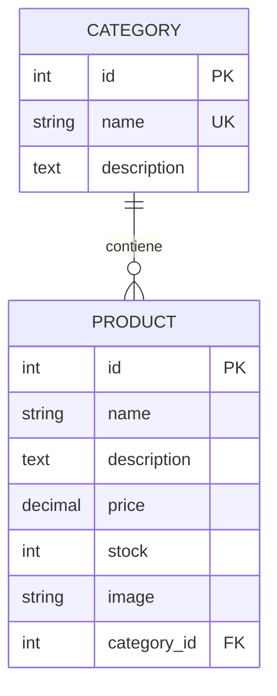

# Diagrama del catálogo

Modelo definido para el catálogo: una categoría agrupa muchos productos y cada producto pertenece a una sola categoría.



## Lectura del diagrama

- `Category` guarda `name` (único) y `description`. Esa descripción viaja dentro del producto en la API.
- `Product` guarda `name`, `description`, `price`, `stock`, `image` y la clave foránea `category`.
- La relación es **1:N**: `Category.products` es el `related_name` usado por Django.

## Representación en la respuesta

`GET /api/products/1/` devuelve la categoría anidada en la misma petición:

```json
{
  "id": 1,
  "name": "Agua mineral 500 ml",
  "price": "1.50",
  "stock": 40,
  "image": "http://127.0.0.1:8000/media/products/agua-mineral-500-ml.png",
  "category": {
    "id": 1,
    "name": "Bebidas",
    "description": "Líquidos listos para consumir, fríos o calientes."
  }
}
```

El campo `category_id` se acepta al crear o modificar (`write_only`), por lo que el mismo serializador sirve para lectura y escritura.
